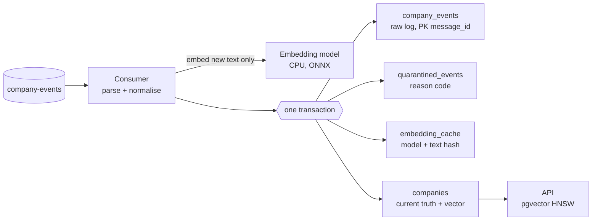

# Design

## Goals and non-goals

The portal needs three things, and they are what I optimised for, in this order:

1. **Latest data wins.** Duplicates, redeliveries and out-of-order events never leave stale data in place.
2. **No lost companies.** Every message is accounted for: applied, recognised as a duplicate, or quarantined with a
   reason. Nothing is silently dropped.
3. **Fast enough for a page load.** Measured, not assumed.

Non-goals for this version: ranking signals other than the business description, authentication, a UI, and
infrastructure the brief didn't ask for. There's no Kafka, no Kubernetes and no dead-letter exchange.

## The feed, measured

I profiled `data/feed.jsonl` before writing any code. The full assumptions table is below.

| | Count |
|---|---|
| Lines (messages) | 2,518 |
| Exact duplicates (same body, so same `message_id`) | 68 |
| Distinct messages | 2,450 |
| Can never be applied (see reasons below) | 32 |
| Applied events | 2,418 |
| Companies | 2,000, every one of which has at least one valid event |
| Struck off | 8, so 1,992 active |
| Companies whose events arrive out of `updatedAt` order | 66 |

## Architecture: what arrived vs. what's true



| Layer | Holds | Why |
|---|---|---|
| `company_events` | Every distinct message: raw bytes, normalised columns, unknown keys (`extra`), and `delivery_count` | Duplicates collapse here (`message_id` primary key, so a redelivery only bumps the count). It's the audit trail and lets the current state be rebuilt without replaying the queue |
| `quarantined_events` | The distinct messages that can never be applied, each with a reason code | Queryable accounting. I can't add a dead-letter exchange to a queue the registry team owns, and a table is easier to report on anyway |
| `companies` | One row per registration number: status, `updated_at`, card fields, `text_hash`, the 384-d vector | What the API reads. It's *derived* from `company_events`, never patched in place |
| `embedding_cache` | `(model, text_hash) → vector` | A description is embedded once per model. Only 172 distinct texts exist across the 2,000 companies, and a state or industry change never re-embeds |

### How "latest wins" is enforced

On every applied event the consumer, in one transaction:

1. inserts the raw event, or bumps `delivery_count` and stops if it's a duplicate;
2. takes a per-company advisory lock (`pg_advisory_xact_lock`), so two consumers can't each miss the other's
   uncommitted event;
3. **rebuilds** that company's row from all of its applied events (`db.REFRESH_COMPANY_SQL`).

The ordering rule is `(updatedAt, struck-off beats upsert, message_id)`:

- **Status** comes from the newest event.
- **Card** (name, description, state, industry) comes from the newest *upsert*.

That makes the final table a pure function of the *set* of events received, independent of arrival order. A
tombstone followed by an older upsert can't revive a company, and a struck-off company still keeps its last known
name. I first sketched "apply the event only if it's newer than the stored row", but that gives different card data
for "upsert then tombstone" and "tombstone then late upsert". Recomputing from the log removes that whole class of
bug. Each company has at most 4 events, so the rebuild costs one indexed query.

`similar/fold.py` implements the same rule in plain Python. Tests check the database against it.

### Failure handling

| Situation | What happens | Ack? |
|---|---|---|
| Applied / duplicate / quarantined | Committed | ack **after** commit |
| Database down, pool timeout | Exponential backoff (0.5 s → 30 s), then requeue. Never quarantined: the data is fine, the system isn't | nack(requeue) |
| Unexpected exception (a bug, or the model crashing on some input) | Requeue up to 5 times, then quarantine as `processing_error` with the exception text | ack once quarantined |
| Crash between commit and ack | Redelivered, recognised by `message_id`, counted as a duplicate | ack |

Prefetch is 32, with 4 worker threads. Embedding happens *before* the transaction and only on a cache miss, so locks
are never held during model inference.

## Assumptions and decisions

| Data trap (seen in the feed) | Decision |
|---|---|
| `registrationNumber` with spaces or lowercase (`" SYN-000123 "`, `syn-000123`): 49 messages | Trim and uppercase, then require `SYN-\d{6}`. The API normalises its path parameter with the same function |
| `registrationNumber` missing (7) or a bare integer like `119` (3), with junk data (`"X"`, `"Trading"`) | Quarantine. Zero-padding `119` into `SYN-000119` would be a guess that could overwrite a real company |
| `updatedAt` with `+08:00` or `Z` | Convert to UTC |
| `updatedAt` without a timezone (14) | **Malaysia time (+08:00).** Not just a convention: every naive value sits within minutes of its +08:00 neighbours in the feed, and for SYN-000521 and SYN-000604 reading it as UTC would make a stale event win (there's a test for this) |
| `updatedAt` as a Unix integer (30, all milliseconds) | ≥ 1e11 means milliseconds, otherwise seconds. Digit strings are accepted too |
| `updatedAt` missing (7) | Quarantine. Using the arrival time would let a stale event win |
| `updatedAt` before 2000 or more than 1 day in the future | Quarantine. A far-future timestamp would pin a company's state forever |
| Exact tie on `updatedAt` | Struck-off beats upsert (don't recommend a possibly-dead company), then the higher `message_id` wins. Deterministic for any arrival order |
| `company-struck-off` | A tombstone: `status = struck_off`. The company is kept, and the API answers `410` for it. A *newer* upsert re-activates it, on the assumption that the registry knows best |
| Upsert with no `data` (5) or `data` as a string (`"companyName=Foo; state=Perak"`, 4) | Quarantine. I don't parse ad-hoc key=value strings |
| Empty-string or `null` fields | `null`. Each upsert is treated as a full snapshot. I checked: the feed never sends a `null` that would wipe a value an older event had set |
| State in mixed case (`SELANGOR`, `kuala lumpur`) | Mapped to the canonical name (`Selangor`, `Kuala Lumpur`, `Pulau Pinang`). Unrecognised values are kept trimmed, not dropped |
| The same description repeated up to 60 times in one field (7 events) | Collapsed to one copy (`collapse_repetition`), then capped at 1,000 characters. Otherwise the text gets truncated by the model and the hash differs from the clean copy |
| Unknown keys (`source`, `ingestedBy`) | Ignored for state and kept in `company_events.extra` |
| Truncated JSON (5) and the literal `null` (1 distinct) | Quarantine |
| No description (39 active companies end up without one) | Stored and visible, but with no embedding. Their own panel returns `200` with `similar: []` and `reason: "no_business_description"`, and they never appear in other companies' panels |
| Message without an AMQP `message_id` | Fall back to sha256 of the body, which is what the producer uses anyway |

## Embeddings: measured, not guessed

**What's embedded:** `natureOfBusiness` only. "What the company does" is the brief's definition of similar.
Industry is missing for about 5% of events, and state has nothing to do with the business.

**Which model:** the feed mixes English and Malay, so I compared three options on the same proxy labels
(`uv run python -m scripts.evaluate`, full output in [`eval/results.md`](eval/results.md)):

| Model | P@4 unique text | nDCG@4 unique text | Malay→English concept acc@1 | Embed 172 texts |
|---|---|---|---|---|
| `BAAI/bge-small-en-v1.5` (suggested) | 0.716 | 0.721 | 0.466 | 1.1 s |
| **`paraphrase-multilingual-MiniLM-L12-v2`** (chosen) | **0.864** | **0.882** | **0.973** | 0.6 s |
| hashed bag-of-words (baseline) | 0.707 | 0.711 | 0.178 | 0.02 s |

- *Unique text* deduplicates identical descriptions first. At company level every model scores ≥ 0.995, because most
  companies share a description with another company in the same industry, so that metric tells the models apart
  hardly at all. I report it in `eval/results.md`, but don't use it to choose.
- *Concept acc@1*: for each of the 73 Malay descriptions, is the closest English description the same business? (For
  example, "Kebun durian…" should land on "Durian orchard…".)
- **Why bge loses:** on Malay text it matches on the *place name*. "Mengusahakan kedai kopi dan kafe di Johor
  Bahru" (coffee shop) gets four parcel-delivery companies "di Johor Bahru" as its nearest neighbours. The
  multilingual model's remaining mistakes are defensible: "Architectural design" sits next to construction firms, and
  "Professional training courses in accounting" next to accounting services.
- I wanted to try `multilingual-e5-small` too, but fastembed doesn't ship it, so I'd have had to export it to ONNX
  myself. MiniLM is also 384-d, CPU-only and in fastembed, so the schema didn't change.
- **Caveat:** same-industry is a weak proxy, and the descriptions are templated, so these numbers say more about
  which model handles Malay than about real recommendation quality.

## API

`GET /companies/{registration_number}/similar?limit=4` (limit 1–20)

```json
{
  "company": {"registrationNumber": "SYN-001550", "companyName": "Sinar Teguh Bakery Sdn. Bhd.",
              "natureOfBusiness": "Operating cafes and coffee shops in the Klang Valley",
              "industry": "Food & Beverage", "state": "Selangor", "updatedAt": "2026-08-14T04:45:52+00:00"},
  "similar": [{"registrationNumber": "SYN-000539", "companyName": "Seri Sejahtera Food Sdn. Bhd.",
               "industry": "Food & Beverage", "state": "Johor", "score": 1.0}, "..."],
  "reason": null
}
```

That's the README mock's company. Our panel has the mock's three food companies, plus a fourth coffee shop where the
mock shows a logistics company.

| Case | Status | `error.code` / `reason` |
|---|---|---|
| Success | 200 | `reason: null` |
| No description | 200 | `similar: []`, `reason: "no_business_description"` |
| Malformed ID or bad `limit` | 400 | `invalid_registration_number`, `invalid_limit`, `invalid_request` |
| Unknown company | 404 | `company_not_found` |
| Struck off | 410 | `company_struck_off` |
| Database unavailable | 503 | `database_unavailable` |

Every error is `{"error": {"code", "message"}}`. `industry` and `state` can be `null`, and the portal shows its own
placeholder ("Industry not listed"). I kept the API honest about missing data rather than inventing display text.

**Search:** cosine distance, using an HNSW index restricted to rows with `status = 'active' AND embedding IS NOT NULL`,
`ef_search = 64` and `iterative_scan = relaxed_order`. The company itself is excluded. Two details:

- The target vector must be a **scalar subquery**. My first version joined to the target row, and the planner then
  can't use the index and falls back to a sequential scan (4.4 ms → 1.4 ms on this data, and the gap grows with the
  table).
- Exact score ties (common, since many companies share a description) are ordered by registration number among the
  results the index returns. Which tied companies make the top k can differ from an exact scan.

**Latency** (`uv run python -m scripts.loadtest`, one uvicorn worker, Windows laptop, Docker Desktop, 2,000
companies, random active IDs, measured from the client):

| Concurrency | p50 | p95 | p99 | Throughput |
|---|---|---|---|---|
| 1 | 13.1 ms | 18.9 ms | 24.3 ms | 73 req/s |
| 8 | 29.1 ms | 43.7 ms | 56.5 ms | 261 req/s |

The SQL itself takes about 1.4 ms (`EXPLAIN ANALYZE`). The rest is Python, HTTP and Docker networking on Windows, so
the first lever would be more uvicorn workers, not database tuning.

## Tests

`uv run pytest`: 88 tests. The database tests run against a separate `companies_test` database and take about 6
minutes, mostly 8 full replays of the feed.

- **Replay is order-independent:** the feed in 3 random shuffles, reversed with 8 concurrent workers, and twice in a
  row. The `companies` table, embeddings included, is identical every time.
- **The database matches the pure-Python rule:** every row equals `fold()` over the same events.
- **Exact accounting:** 2,518 = 2,450 distinct + 68 duplicates; 2,450 = 2,418 applied + 32 quarantined, with the
  exact count per reason; 2,000 companies, 1,992 active.
- **Targeted cases:** out-of-order update; old update after a tombstone; lowercase and padded IDs; Unix ms vs ISO;
  missing description; broken JSON plus its redelivery; a state change that must not re-embed.
- **Consumer acks:** database down → requeue forever, never quarantine; poison message → quarantined after 5 tries.
- **API contract:** each status code in the table, including 503 against a closed port.
- **Unit tests** for every normaliser.

I also ran the real pipeline end to end: `just up && just publish && just drain && just report` gives the accounting
above with `"balanced": true`, using the real model, in about 16 s.

## 10x (and beyond)

Ten times the volume is 20k companies and roughly 25k events, which is still small. In order of what I'd do:

1. **More consumers.** The per-company advisory lock already makes concurrent consumers safe. Raise the worker count
   and run several processes.
2. **Batch embedding.** Collect cache misses across in-flight messages and embed them 32 at a time. With templated
   descriptions the cache hit rate is already above 90%.
3. **Search:** tune HNSW `m` / `ef_construction` / `ef_search` against recall measured with exact scans. At millions
   of rows, consider `halfvec` to halve memory.
4. **API:** several uvicorn workers. Cache the response per company for a short time, invalidated by `refreshed_at`.
   Read replicas for the API, so consumer writes don't compete with page loads.
5. Partition `company_events` by month if the log gets large. It's append-only, so that's easy.

## Monitoring

- **Queue:** depth and age of the oldest message (consumer lag), redelivery rate.
- **Correctness:** quarantine rate by reason, with an alert on a new reason or a spike, which usually means an
  upstream change. Also `processing_error` count (should be 0) and whether `just report` balances.
- **Embeddings:** inference latency and failures, cache hit rate, and the share of active companies without a vector.
- **API:** p50/p95/p99 by status code, and the 503 rate.
- **Quality canary:** a fixed set of company IDs whose expected neighbours are known, checked after every deploy or
  model change. The `eval/` script is the starting point.

## What's left

- **Changing the model** needs a backfill command: re-embed the distinct texts under the new model, then refresh
  `companies.embedding`. The cache is already keyed by model, so both models can coexist during the switch.
- **Replaying quarantined messages after a normaliser fix:** the raw bytes are stored, but there's no command yet.
- **Diversity:** many companies share one description, so a panel can be four identical businesses. A small MMR
  re-rank, or preferring different states, would help.
- **City names inside descriptions** pull matches towards location ("…di Johor Bahru"). Stripping known place names
  before embedding is worth testing with `scripts.evaluate`.
- **The end-to-end run through RabbitMQ** is a manual `just demo`, not an automated test.
- No authentication or rate limiting on the API.

## AI tools used

I used Claude Code (Anthropic's coding agent) for testing and bug finding: writing and running test cases, replaying
the feed against the database, and tracking down failures. Bugs it helped find and fix include:

- **Slow database connections on Windows.** `localhost` resolved to IPv6 (`::1`) first and stalled, so pool
  connections timed out. All defaults now use `127.0.0.1`.
- **The vector index wasn't being used.** The first version of the similarity query joined to the target row, and
  Postgres chose a sequential scan (4.4 ms). Rewriting the query vector as a scalar subquery makes it use the HNSW
  index (1.4 ms).
- **A test-ordering bug.** A module-scoped fixture could refill the database after another test had truncated it.
  Those tests now reset the database themselves.
- **A Unicode crash.** Printing evaluation results failed on the Windows `cp1252` console.

The numbers in this document come from running the tests, the end-to-end pipeline, the evaluation and the load test.
